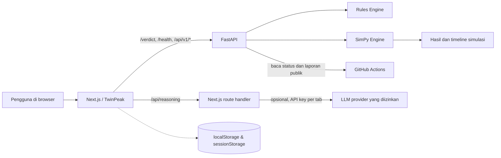

# 01 — Gambaran Sistem TwinPeak

## 1. Untuk apa TwinPeak dibuat?

Di banyak tim, keputusan kesiapan kapasitas dan kesiapan rilis sering tersebar di hasil tes, spreadsheet, obrolan, dan catatan rapat. TwinPeak menyatukan sebagian alur tersebut dalam sebuah demonstrasi: pengguna mendeskripsikan server dan beban kerja, menjalankan model, membaca risikonya, lalu memakai hasil tersebut sebagai bahan review.

Istilah **Digital Twin** pada proyek ini merujuk pada **model simulasi kapasitas berbasis parameter**, bukan replika infrastruktur yang selalu tersinkronisasi dengan telemetri produksi. Ini perbedaan yang perlu dijelaskan secara konsisten pada presentasi dan dokumentasi.

## 2. Komponen yang berjalan sekarang

Komponen utama:

1. **Frontend:** Next.js dan React, berada di `frontend/`. Menyajikan landing page, demo role, simulasi, perbandingan, laporan, showcase, dan halaman engineering.
2. **Backend:** FastAPI di `backend/main.py` dan `backend/app/`. Menyediakan kontrak API Rules/SimPy, inspeksi simulasi, dan pembacaan bukti CI/CD.
3. **Engine:** `backend/app/engines/rules.py` dan `simpy.py`. Input spesifikasi server dan workload diproses menjadi verdict, bottleneck, utilisasi, dan alasan.
4. **Penyimpanan demo:** kombinasi `localStorage` untuk history/record dan `sessionStorage` untuk pemilihan persona serta konfigurasi LLM sementara. **Belum ada DB persisten di server.**
5. **Quality evidence:** GitHub Actions dan laporan JSON terpublikasi. Halaman Engineering Quality membaca bukti eksekusi aktual; bukan membuat angka tes sendiri.

## 3. Apa bedanya Rules dan SimPy?

| Aspek | Rules | SimPy |
| --- | --- | --- |
| Pendekatan | Formula demand/capacity | Simulasi discrete-event |
| CPU | RPS × waktu CPU / jumlah core | Core ditempati request selama pemrosesan |
| RAM | Koneksi dinyatakan × memori/request | Alokasi memori selama request berada dalam proses |
| Koneksi | Koneksi yang **dideklarasikan** pada input | Lama okupansi slot koneksi yang **terjadi** dalam simulasi |
| Tujuan | Baseline perhitungan yang transparan | Memahami antrean dan penggunaan sumber daya sepanjang waktu |
| Catatan | Tidak menangkap antrean berbasis kejadian | Menggunakan seed tetap dan asumsi model tertentu |

Verdict dasar: **will_survive** ketika puncak utilisasi di bawah 80%, **at_risk** pada 80–100%, dan **will_crash** di atas 100%. UI juga memiliki **Tidak Dapat Dinilai** untuk evaluasi yang gagal menghasilkan keputusan yang sah; itu bukan hasil keempat yang dihitung oleh engine Rules/SimPy.

Perbedaan verdict kedua engine **tidak otomatis menunjukkan salah satu rusak**. Misalnya `max_connections = 1` dapat membuat slot SimPy sibuk hampir terus-menerus, walaupun `concurrent_connections` yang dideklarasikan pada Rules rendah. Lihat halaman `/methodology` dan tes regresi untuk kasus tersebut.

## 4. Peta halaman

| URL | Kegunaan |
| --- | --- |
| `/` | Landing page dan contoh evaluasi kapasitas |
| `/demo` | Pilih salah satu dari lima persona; tidak meminta password |
| `/login` | Jalur login demo lama dengan pilihan role dan password demo |
| `/dashboard` | Ringkasan pekerjaan sesuai persona |
| `/alignment` | Penilaian release, review Technical Lead, dan catatan keputusan |
| `/incident` | Pencatatan insiden dan pengujian mitigasi |
| `/signoff` | Persetujuan/penolakan pada alur demo |
| `/reports` | Riwayat dan ekspor laporan |
| `/access` | Ringkasan peran dan menu yang terlihat di demo |
| `/showcase` | Tur teknis yang bisa dilihat semua persona |
| `/simulation` | SimPy workbench dan timeline |
| `/compare` | Skenario normal, 2×, dan 3× |
| `/methodology` | Asumsi, batasan, dan ambang verdict |
| `/developer` | API Explorer |
| `/quality` | Hasil tes dan bukti GitHub Actions |
| `/settings` | Konfigurasi LLM sementara per tab |

## 5. Hal-hal yang belum boleh diklaim

- Tidak ada koneksi langsung ke server produksi untuk membaca CPU, RAM, atau antrean secara berkelanjutan.
- Tidak ada generator beban yang melakukan serangan trafik atau load test ke server asli.
- Tidak ada database bersama yang menjamin konsistensi antar pengguna dan perangkat.
- Role di UI tidak setara dengan izin di API backend.
- Sign-off dalam demo tidak menjalankan deployment sungguhan.
- LLM hanya dapat membantu menyusun penjelasan; ia tidak menggantikan hasil SimPy.

Batasan tersebut justru menjadi dasar untuk [rencana migrasi](07-checklist-migrasi.md), bukan sesuatu yang perlu disembunyikan.

## 6. Referensi source code

- `frontend/lib/demo.ts`: persona, akses halaman demo, dan penyimpanan record di browser.
- `frontend/lib/model.ts`: kontrak request dari frontend, nilai default, dan history lokal.
- `frontend/lib/llm-session.ts`: konfigurasi LLM per tab.
- `backend/app/schemas.py`: skema Pydantic dan validasi request.
- `backend/app/engines/{rules,simpy}.py`: dua model kapasitas.
- `backend/main.py`: endpoint tambahan inspeksi dan laporan kualitas.
- `vercel.json`: routing layanan Vercel.