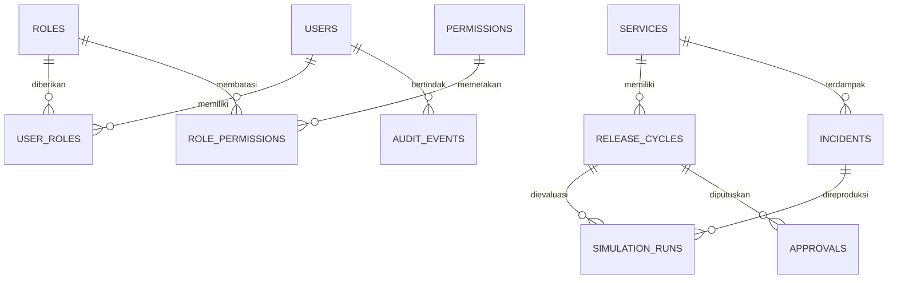

# 04 — Rencana Database dan Kebutuhan Minimum

**Status dokumen: usulan arsitektur.** Source TwinPeak yang ditinjau belum memiliki ORM, migration script, atau koneksi database aplikasi. Record release dan insiden masih disimpan di browser. Bagian ini merupakan rancangan yang bisa dipakai untuk diskusi tim backend, infrastruktur, keamanan, dan pemilik proses bisnis.

## 1. Mengapa perlu database?

Dalam demo, pergantian role dapat dilakukan pada browser yang sama sehingga record QA terlihat ketika role berikutnya dipilih. Dalam penggunaan perusahaan, mekanisme itu tidak cukup: reviewer di laptop lain harus melihat record yang sama; approval harus punya identitas penandatangan; dan informasi perlu bertahan saat perangkat berganti.

Database dibutuhkan untuk menyimpan **identitas, record simulasi, release, insiden, keputusan, serta audit** secara terpusat. Storage yang persisten tidak otomatis membuat suatu proses aman; tetap dibutuhkan autentikasi, authorization, dan pengendalian integritas data.

## 2. Pilihan database

Rekomendasi awal: **PostgreSQL**. Alasannya: transaksi relasional, foreign key, indeks, dan kemudahan membangun riwayat keputusan yang saling berhubungan. PostgreSQL 16 atau versi lain yang **masih didukung oleh standar perusahaan** bisa menjadi baseline; putuskan versi final bersama DBA sebelum implementasi.

Alternatif seperti SQL Server, MySQL, atau layanan managed DB dapat dipertimbangkan jika organisasi sudah memiliki standar sendiri. Belum ada alasan dari source aplikasi saat ini untuk mengharuskan database tertentu.

### Perkiraan kapasitas awal (untuk perencanaan, bukan hasil benchmark)

| Lingkungan | Alokasi awal yang bisa dipertimbangkan | Keterangan |
| --- | --- | --- |
| Developer | PostgreSQL lokal atau container untuk pengembangan | Tidak dipakai oleh aplikasi demo saat ini |
| Staging kecil | 1–2 vCPU, RAM 2–4 GB, disk SSD 20 GB | Angka estimasi; sesuaikan jumlah tes dan report |
| Produksi | Tentukan setelah menghitung jumlah user, record, ukuran payload, dan retensi | Sebaiknya layanan terkelola/HA bila diwajibkan |

**Perhitungan yang harus dilakukan sebelum sizing final:** jumlah user aktif, jumlah evaluasi/hari, ukuran timeline yang akan disimpan, jumlah lampiran/PDF, ukuran audit event, retensi (misalnya 1/3/5 tahun sesuai kebijakan), kebutuhan backup, RPO/RTO, dan target pertumbuhan data. Tidak semua timeline SimPy harus disimpan mentah secara permanen.

## 3. Entitas data yang disarankan

| Entitas | Contoh isi | Tujuan |
| --- | --- | --- |
| `users` | ID, email unik, nama, status akun, waktu dibuat | Identitas pengguna |
| `roles` | `qa`, `lead`, `engineer`, `manager`, `support`, `admin` | Grup hak akses; `admin` adalah usulan, bukan role demo saat ini |
| `permissions` | `simulation:run`, `release:review`, `signoff:decide` | Hak yang bisa dikontrol API |
| `user_roles`, `role_permissions` | Relasi ID dan audit perubahan | Banyak-ke-banyak role dan permission |
| `services` | Kode/nama aplikasi, pemilik layanan | Lingkup objek yang dinilai |
| `release_cycles` | Service, nomor cycle, status, pembuat | Satu kandidat release dan riwayat siklus |
| `simulation_runs` | Engine, input, output, bottleneck, versi model, checksum, timestamp | Menyimpan bukti evaluasi asli dan dapat ditelusuri |
| `incidents` | Service, gejala, status, pemilik, waktu kejadian | Tindak lanjut gangguan |
| `approvals` | Release, aktor, keputusan, alasan, waktu, versi | Persetujuan yang dapat ditelusuri |
| `audit_events` | Aktor, aksi, objek, sebelum/sesudah yang disanitasi, waktu, request ID | Rekam kejadian untuk audit |
| `attachments` atau `reports` | Metadata berkas, checksum, lokasi object storage | Jika PDF dan lampiran akan diarsipkan |

Gunakan **UUID atau ID unik yang dihasilkan server**, bukan hanya ID string dari browser. Tambahkan `created_at`, `updated_at`, pembuat/perubah, dan constraint yang sesuai. Untuk data keputusan, jangan hanya menyimpan status terakhir; simpan pula **histori transisinya**.

## 4. Aturan penyimpanan hasil simulasi

Satu run sebaiknya menyimpan:

1. Input `spec` dan `load` lengkap, engine yang digunakan, versi aplikasi/model, serta seed/settings simulasi yang relevan.
2. Verdict, confidence **heuristik**, bottleneck, utilisasi, dan alasan yang dikembalikan backend.
3. Status eksekusi: berhasil atau tidak dapat dinilai, termasuk kode kesalahan yang disanitasi jika gagal.
4. Timestamp server, user yang menjalankan, serta kaitan ke release atau incident.
5. Jika perlu, timeline dalam tabel terpisah atau object storage dengan retensi dan batas ukuran yang disepakati.

**Jangan merekonstruksi verdict dari data yang sudah dibulatkan** untuk approval historis. Simpan hasil asli dari engine sebagai bukti, beserta metadata versi agar dapat diaudit.

## 5. Persyaratan operasional database

- **Network:** DB hanya bisa diakses aplikasi dan administrator yang sah; tidak mengekspos port database ke internet publik.
- **Akun:** buat user DB khusus aplikasi dengan prinsip least privilege; migration user dipisahkan jika memungkinkan.
- **Secrets:** simpan credential di secret manager / environment server, bukan dalam repository atau frontend.
- **Enkripsi:** gunakan TLS untuk koneksi apabila layanan terpisah, dan enkripsi at-rest sesuai kebijakan.
- **Backup:** jadwalkan backup otomatis dan uji restore secara berkala. Backup yang belum pernah diuji restore belum membuktikan kesiapan pemulihan.
- **Transaksi:** keputusan sign-off, perubahan status, dan audit event harus konsisten dalam satu transaksi atau desain andal yang setara.
- **Migrasi skema:** gunakan tool migration terkontrol, misalnya Alembic jika memilih SQLAlchemy pada backend Python. Keduanya **belum menjadi dependency proyek**.
- **Indeks:** minimal pada foreign key, email unik, service, status, `created_at`, dan relasi release/incident. Tinjau query plan setelah ada data nyata.
- **Retensi:** definisikan lama penyimpanan log/audit, report, dan timeline bersama fungsi bisnis serta kepatuhan.

## 6. Hal yang harus diputuskan sebelum coding

- Apakah database menggunakan layanan managed organisasi atau host sendiri?
- Apakah satu user boleh memiliki beberapa role dan beberapa service?
- Siapa yang boleh melihat report lintas project? Apakah perlu pemisahan akses per service/tenant?
- Berapa batas ukuran report, attachment, dan timeline?
- Berapa RPO/RTO dan periode retensi yang disyaratkan?
- Apakah data demo akan diimpor atau cukup diarsipkan sebagai contoh?

Hasil keputusan ini menjadi masukan untuk [user management](05-rencana-user-management.md) dan [checklist migrasi](07-checklist-migrasi.md).