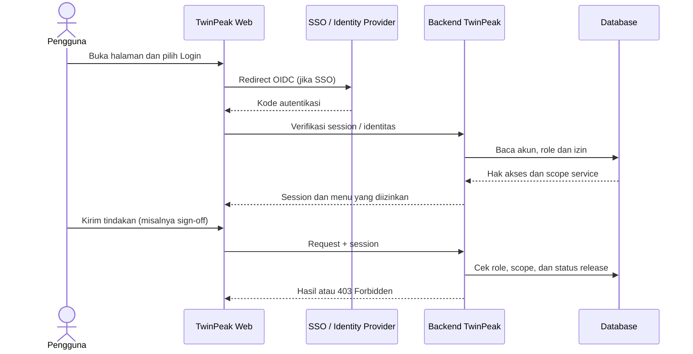

# 05 — Rencana Implementasi User Management

**Status: belum ada di aplikasi saat ini.** TwinPeak memiliki lima persona dengan menu berbeda untuk keperluan demonstrasi, tetapi itu belum setara dengan akun, login, izin API, dan audit yang aman. Dokumen ini menjadi dasar pekerjaan implementasi user management yang sesungguhnya.

## 1. Kondisi sekarang

Pada `/demo`, pengguna memilih **QA Tester, Technical Lead, Integration Engineer, Project Manager, atau Support & Monitoring** tanpa password. Pilihan role disimpan dalam `sessionStorage`. Pada `/login`, tersedia jalur demo lama memakai password bersama yang ditampilkan di frontend. Dokumen release/insiden tersimpan di `localStorage` browser dan pembatasan menu dilakukan di frontend.

Konsekuensinya: **jangan gunakan pemilihan persona sebagai kontrol akses data perusahaan**. Memilih role berbeda pada browser tidak membuktikan identitas orang yang menjalankan tindakan tersebut. API evaluasi juga belum menerapkan otorisasi berdasarkan kelima role.

## 2. Model yang diusulkan

Pilih salah satu sumber identitas yang disetujui organisasi:

- **SSO korporat** menggunakan OpenID Connect (OIDC), misalnya melalui identity provider yang memang sudah dikelola perusahaan. Ini opsi yang paling praktis bila infrastruktur SSO sudah ada.
- **Akun lokal sementara** bila SSO belum tersedia. Harus dilengkapi password hashing yang kuat, proses reset aman, MFA sesuai kebijakan, pembatasan percobaan login, dan pengelolaan session. Hindari password bawaan bersama.

Untuk aplikasi internal, **jangan membangun sistem password sendiri dari nol tanpa alasan yang kuat**. Tinjau integrasi identity provider dan kebutuhan audit bersama tim keamanan.

### Alur login yang dituju

Pada implementasi akhirnya, browser sebaiknya memakai **session cookie `HttpOnly`, `Secure`, `SameSite`** yang sesuai dengan arsitektur. Token rahasia tidak perlu ditempelkan ke localStorage. Jika memakai cookie autentikasi, tambahkan proteksi CSRF untuk request yang mengubah data sesuai model ancamannya.

## 3. Role dan izin minimum

Contoh matriks awal untuk dibahas pemilik proses (ini **usulan**, bukan kebijakan akses yang sudah aktif):

| Tindakan | QA | Technical Lead | Engineer | Manager | Support |
| --- | :---: | :---: | :---: | :---: | :---: |
| Melihat dashboard sesuai scope | ✓ | ✓ | ✓ | ✓ | ✓ |
| Menjalankan simulasi | ✓ | Opsional | ✓ | Opsional | Opsional |
| Membuat evidence alignment | ✓ | — | — | — | — |
| Review alignment / kembali ke Dev | — | ✓ | — | — | — |
| Memberikan sign-off resmi | — | — | — | ✓ | — |
| Mencatat insiden/eskalasi | — | — | — | — | ✓ |
| Menganalisis & menguji mitigasi insiden | — | — | ✓ | — | — |
| Melihat report terkait service | ✓ | ✓ | ✓ | ✓ | ✓ |
| Kelola akun/role | — | — | — | — | — |

Role **Administrator** belum ada sebagai persona demo, tetapi nantinya dibutuhkan untuk provisioning akun dan role. Jangan otomatis memberi Administrator akses untuk **menyetujui release**; pisahkan tugas pengelolaan akun dan keputusan bisnis apabila diperlukan oleh prinsip *separation of duties*.

**Catatan:** UI saat ini membuka menu *technical showcase* untuk seluruh persona. Pada implementasi perusahaan, akses ke API Explorer, CI job, konfigurasi LLM, dan test evidence juga perlu kebijakan tersendiri; jangan mengasumsikan semuanya aman untuk semua user hanya karena tersedia saat demo.

## 4. Pemeriksaan izin harus dilakukan di backend

Contoh kontrol yang perlu ditambahkan:

- Endpoint pembuatan alignment: hanya akun dengan `release:create`, pada service yang boleh diakses.
- Endpoint review Technical Lead: `release:review` serta status record yang memang bisa direview.
- Endpoint sign-off: `signoff:decide`, verifikasi identitas aktor, reason, status workflow dan versi kandidat.
- Endpoint insiden: hak membuat dan mengubah insiden dipisah; engineer hanya boleh menambahkan hasil analisis sesuai scope.
- Endpoint report: selalu filter data berdasarkan role dan hak akses ke service, bukan berdasarkan tombol yang disembunyikan di UI.
- Endpoint user management: hanya `user:manage` atau admin yang berwenang; setiap perubahan role direkam.

Untuk permintaan tanpa session sah, gunakan `401 Unauthorized`. Untuk session sah tetapi tidak punya izin, gunakan `403 Forbidden`. Untuk objek di luar scope, pilih kebijakan respons yang konsisten dan aman agar tidak membocorkan keberadaan data.

## 5. Modul yang perlu dibuat

1. **Accounts:** status aktif/nonaktif, email unik, tautan ke user ID dari identity provider, penetapan role.
2. **Sessions:** login, logout, session expiry, revocation, serta deteksi session yang sudah dicabut.
3. **Roles & permissions:** pembacaan izin per API action, termasuk pembatasan berdasarkan service/project.
4. **User administration:** tambah/undang user, ubah role, nonaktifkan akun, riwayat perubahan.
5. **Authorization middleware/dependency:** pemeriksaan izin pada setiap endpoint backend yang relevan.
6. **Audit trail:** catat siapa melakukan apa, kapan, terhadap objek mana, dengan hasil apa.
7. **UI:** menu mengikuti izin dari backend, tetapi backend tetap menjadi sumber kebenaran.

Jika memilih FastAPI + PostgreSQL, pustaka seperti SQLAlchemy, Alembic, driver PostgreSQL, serta library OIDC/session dapat dievaluasi. **Paket ini belum ada di `backend/requirements.txt` sekarang.**

## 6. Skenario tes yang wajib ada

- Login sah, login gagal, sesi kedaluwarsa, akun nonaktif, logout dan revokasi session.
- QA tidak dapat mengirim sign-off dengan memanggil API langsung, meskipun ia mengubah tampilan browser.
- Manager tidak dapat menyetujui release milik service yang tidak diizinkan.
- Pengguna tidak dapat mengubah owner/role melalui manipulasi request JSON.
- Perubahan role baru berlaku sesuai aturan sesi dan tercatat dalam audit log.
- Dua perangkat login sebagai user yang sama atau berbeda tetap membaca record yang konsisten.
- API melindungi akses ke record dengan ID yang ditebak (*broken object-level authorization / IDOR*).
- Kredensial dan isi token tidak tampil di log, PDF, export, respons error, atau telemetri.

Tambahkan integration test database transaksi serta E2E multi-user, bukan hanya tes menu terlihat/tersembunyi.

## 7. Urutan implementasi yang aman

1. Sepakati daftar role, permission, dan scope data bersama bisnis.
2. Buat tabel pengguna, role, permission, dan audit di database staging.
3. Integrasikan SSO/session tanpa mengganggu layanan simulasi yang sudah ada.
4. Amankan seluruh endpoint berbasis data dan pengambilan keputusan di backend.
5. Hubungkan UI ke session yang sesungguhnya; hilangkan ketergantungan pada `sessionStorage` sebagai sumber identitas.
6. Migrasikan record demo yang memang perlu disimpan; jangan menyalin `localStorage` tanpa validasi.
7. Uji keamanan, audit, data isolation, dan pemulihan sebelum membuka akses perusahaan.
8. Baru pensiunkan jalur password demo serta persona bebas pada deployment internal.

Lihat [checklist migrasi](07-checklist-migrasi.md) untuk *acceptance criteria* dan rencana cutover.