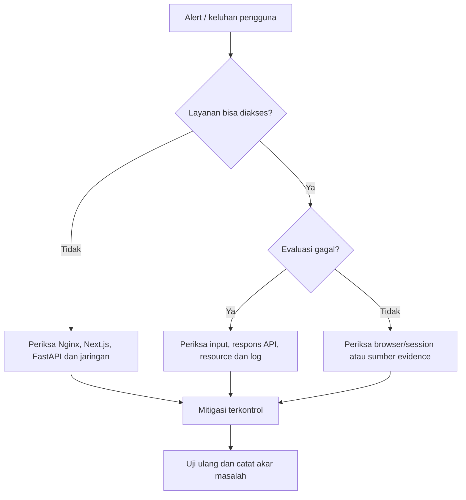

# 08 — Operasional, Monitoring, dan Keamanan

Ini panduan kerja harian untuk demo/staging, sekaligus daftar kontrol yang perlu disiapkan sebelum aplikasi menjadi sistem internal. **Bukan** sertifikasi bahwa deployment saat ini telah memenuhi semua kontrol tersebut.

## 1. Peran operasional

- **Pemilik aplikasi:** menentukan kebutuhan bisnis, batas akses, dan penerimaan perubahan.
- **Tim platform:** menjaga server, domain, TLS, proses deployment, backup, dan log.
- **Tim backend/model:** mengelola kontrak API, kompatibilitas model, dan regresi numerik.
- **Tim frontend:** menjaga pengalaman pengguna, aksesibilitas, dan perilaku browser.
- **QA/security:** menguji kasus gagal, hak akses, dependency, dan skenario lintas role.

Ini fungsi organisasi, bukan berarti harus dibagi satu orang per fungsi.

## 2. Checklist operasional harian

1. Pastikan domain terbuka dan `GET /health` menghasilkan status OK.
2. Periksa error FastAPI dan Next.js pada systemd/journal atau logging platform.
3. Periksa CI pada commit yang terpasang; bedakan hasil `main` saat ini dan commit deployment yang benar-benar live.
4. Cek tingkat penggunaan resource host dan ruang disk; ambang alert ditentukan berdasarkan baseline, bukan nilai tebak-tebakan.
5. Periksa apakah link evidence GitHub Actions dan laporan quality tersedia.
6. Untuk lingkungan yang sudah memakai DB: cek pekerjaan backup, replikasi jika ada, dan masa retensi.
7. Pantau masa berlaku sertifikat TLS serta hasil audit kerentanan dependency.

**Catatan:** `/health` sekarang hanya memberi respons `{"status":"ok"}` dari aplikasi FastAPI. Itu **liveness check**, bukan bukti lengkap bahwa semua dependency, model, database masa depan, atau external provider siap dipakai.

## 3. Penanganan insiden operasional

Gunakan alur berikut untuk masalah aplikasi yang sebenarnya (bukan simulasi insiden di menu demo):



Contoh pemeriksaan di VM:

```bash
sudo systemctl status twinpeak-web twinpeak-api
sudo journalctl -u twinpeak-api -n 100 --no-pager
sudo journalctl -u twinpeak-web -n 100 --no-pager
sudo nginx -t
curl --fail http://127.0.0.1:8000/health
```

Jangan menyalin token, rahasia, atau isi data pengguna ke tiket, screenshot, atau log publik.

## 4. Keamanan yang sudah ada vs yang belum

| Area | Yang ada sekarang | Yang perlu ditambahkan sebelum production |
| --- | --- | --- |
| API key FastAPI | Opsi `API_KEY` untuk Bearer token pada beberapa endpoint | Identitas user dan authorization terpadu |
| Session role | `sessionStorage` persona demo | Session backend, expiry, revocation, scope |
| Record workflow | `localStorage` browser | Database bersama + audit |
| Input backend | Pydantic, termasuk perlindungan input numerik tidak finite | Validasi domain tambahan, limit ukuran/rate, fuzz testing |
| API security | Sebagian security headers dan allowlist endpoint LLM | Threat model, authz API, CSRF, hardening CORS |
| CI | Pytest, Playwright, TypeScript, dependency audit, Bandit | Pentest/DAST dan kontrol supply chain sesuai risiko |
| LLM | Endpoint terbatas, tanpa penyimpanan kunci server dalam fitur tersebut | Kebijakan data dan secret handling organisasi |

**Perhatian terhadap CORS:** backend yang ada mengizinkan semua origin untuk akses tertentu. Ini tidak menggantikan autentikasi atau kebijakan domain perusahaan. Tinjau ulang sebelum API memproses data sensitif.

## 5. Data dan rahasia

- Jangan masukkan API key yang masih dipakai produksi ke `.md`, Git, screenshot, atau PDF.
- Jangan menyimpan password sebagai teks biasa di database.
- Jangan menyimpan access token OIDC di `localStorage` bila arsitektur memakai cookie session yang aman.
- Terapkan data minimization: simpan parameter simulasi dan evidence yang diperlukan saja.
- Definisikan sanitasi input LLM; prompt yang dikirim ke provider eksternal dapat dikenai kebijakan retensi provider.
- Terapkan backup ber-enkripsi dan uji restore secara berkala.
- Akses ke laporan quality publik perlu dinilai: jangan pernah mempublikasikan stack trace, environment variable, atau credential sebagai evidence.

## 6. Backup, restore, dan rollback

### Saat ini (demo tanpa DB)

Source code ada di Git dan hasil quality di GitHub Actions. Workflow data tersimpan lokal di browser sehingga **tidak tercakup backup server**. Jika browser terhapus, data demo bisa hilang. Ekspor CSV/PDF yang tersedia dapat membantu dokumentasi manual, tetapi tidak otomatis membuat backup yang lengkap dan dapat dipulihkan.

### Setelah memakai DB

- Jadwalkan backup database penuh/inkremental sesuai kebijakan.
- Catat **RPO** (batas kehilangan data yang dapat diterima) dan **RTO** (lama pemulihan maksimal).
- Uji restore ke lingkungan terisolasi.
- Pisahkan migration skema dari deployment aplikasi dengan langkah rollback yang realistis.
- Simpan backup dan kunci enkripsinya di lokasi berbeda dengan kontrol akses yang jelas.
- Uji apakah audit event dan approval tetap utuh setelah pemulihan.

## 7. Observability yang perlu dibangun

Minimal: **request ID**, durasi permintaan, status HTTP, error rate, antrian simulasi, utilisasi host, jumlah request ke engine, dan ketersediaan backend. Jangan menambahkan angka latency/p95 yang tampak nyata di dashboard apabila belum ada sumber telemetry yang benar-benar mengukurnya.

Untuk versi produksi, latensi engine dan tingkat kegagalan per endpoint bisa dimonitor melalui instrumentation pada backend serta metrik aplikasi, dengan label yang jelas membedakan **data operasional server TwinPeak** dari **hasil simulasi server target**.

## 8. Kebiasaan release yang disarankan

- Kerjakan di branch dan lakukan PR review.
- Jalankan seluruh tes sebelum merge.
- Gunakan commit/tag yang sama untuk build dan deploy.
- Catat migration, perubahan konfigurasi, dan risiko rollback.
- Verifikasi environment production READY **dan** endpoint dari domain publik yang sebenarnya.
- Tutup issue setelah fix sudah dibuktikan oleh tes dan deploy jika relevan.
- Gunakan pesan commit yang sederhana dan deskriptif, misalnya `Fix timeout handling` atau `Add release audit log`; hindari klaim berlebihan.